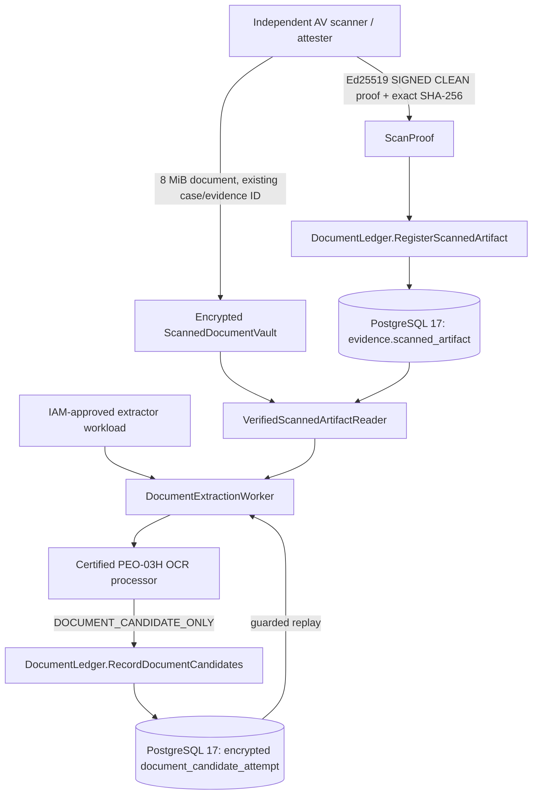

# PEO-03K — signed scan custody and encrypted document candidate ledger

**Governance:** ADR-BCP-023/026/027, Shared evidence/v1; builds on merged PEO-03H/03J. This is the first **PostgreSQL-backed internal integration implementation**, not a certified live CIPC/SARS/PSP service.

## Authoritative boundary and data-flow

### Registered canonical migration 000119

- `evidence.scanned_artifact`: immutable document SHA-256, scanner/version, signed CLEAN attestation and artifact identity. No document bytes and no user-supplied CLEAN flag accepted as independent proof.
- `evidence.document_candidate_attempt`: append-only attempt per `(actor_id,idempotency_key)` with exact case/claim/evidence/artifact, processor/version, receipt digest and **AES-256-GCM ciphertext** only. The crypto additional authenticated data includes all resource, actor, client, idempotency and digest selectors.
- Default SQL PUBLIC privileges explicitly revoked. Runtime role grants must be applied by approved infrastructure/bootstrap, not a migration that grants arbitrary users access.

### Enforced guards

- The scanner private signing key is **not** a Control Plane dependency. Operators mount only approved `ed25519.PublicKey` entries keyed by `scanner_id/scanner_version`; a valid clean attestation must bind document ID, artifact ID, MIME, document digest, scan time, scanner ID/version and outcome.
- `ScannedDocumentVault` encrypts 8 MiB max PDF/PNG/JPEG blobs under an externally mounted **32-byte key** into private non-overwrite files. Existing `SealedVault` remains reserved for small official-source responses. Object bytes never enter PostgreSQL.
- `VerifiedScannedArtifactReader` checks dedicated IAM workload identity, current AVAILABLE evidence state, independent scanner trust/key, signed proof and decrypted document SHA-256. No browser or applicant document bytes are admitted to the extraction worker.
- `DocumentLedger` uses row locks in canonical case → claim → evidence order, enforces current case and claim statuses, subject, purpose, exact evidence link, expiry, current AVAILABLE evidence and matching signed-scanner provenance digest at write/replay. Restricted/destroyed evidence denies decryption.
- Candidate ledger is not a VerificationCheck, VerificationResult, LegalEntity, tax-compliance or tenant activation channel.

### Verification

- Unit tests: immutable AES-GCM document custody, Ed25519 signature alterations, exact digest and artifact binding, tampered ciphertext/AAD, disallowed VERIFIED receipts, wrong IAM client and revoked scan key.
- `TestPEO03KPostgresSignedScannedArtifactEncryptedCandidateLifecycle` (when `TEST_DATABASE_URL` is supplied) covers PG17 migration, scanner registration, private scanned read, OCR candidate-only receipt, encrypted insert, durable replay and deny-after-RESTRICTED.
- No real government responses, passwords or private tax identifiers are used.

## Composition required for staging acceptance

The implementation intentionally **does not activate** the workflow merely by constructing these components. An operator-owned composition root must inject:

1. Independently certified malware scanner runtime holding the Ed25519 **private** signing key, with its own IAM identity, scan submission pipeline, and clean/quarantine/expiry/revocation evidence. No applicant may generate scan verdicts.
2. The approved scanner public trust anchors, the OEV-02 durable encrypted artifact store, and a separate 32-byte mounted envelope key; local encrypted volume is for tests or operator-controlled staging only. Replace with AWS S3 Object Lock/KMS custody adapter and audited access controls for production.
3. The candidate encryption key, dedicated `baobab-document-extractor-staging` client, certified document processor OAuth token hook and `DocumentLedger`. Rotation/rewrap, retention, deletion, purging and immutable audit policy remain environment responsibilities.
4. Protected E2E CI against live IAM issuer, real staging custody and independent scan attestations; negative tests must prove caller/client and tenant isolation, quarantine rejection, evidence restriction, duplicate request replay, leaked token denial and KMS key denial.

Do **not** mark founding-business registration, corporate ownership, SARS tax standing or PSP certification VERIFIED based on OCR, document scans or any synthetic fixture.

**Next gate:** protected staging composition + external account/provider certification and operational evidence; then reassess EA Implementation Plan v2 go/no-go based on explicit controls, not PR existence.
