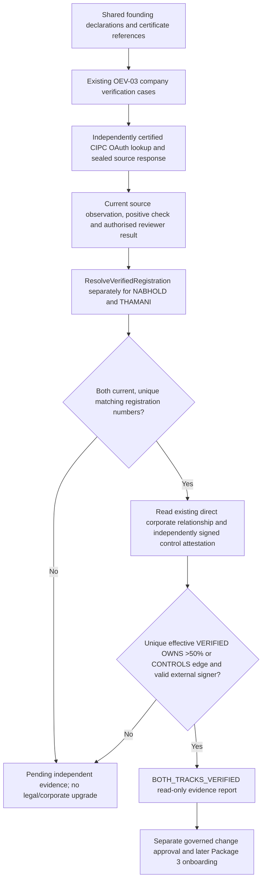

# Package 2 / PEO-04A — Independent CIPC registration and corporate-control reconciliation

**Status:** implementation increment under accepted ADR-BCP-026 PEO-T20 and ADR-BCP-027 LA-T27. **No live CIPC or third-party ownership assertion has been verified by this PR.** The controlled founding-business creation/tenant provisioning belongs to Package 3, not here.

## Source-of-truth boundary

Baobab Shared `contracts/legal-entity/registry.yaml` declares first-party identities and certificate references. It does **not** independently certify incorporation or control:

| First-party key | Reported company name | Declared CIPC number | Documentary evidence | Current admissible conclusion |
|---|---|---|---|---|
| `NABHOLD` | NABHOLD GROUP AFRICA (Pty) Ltd | `2026/029839/07` | `baobab-platform/nabhold:docs/go-live/evidence/G01/production/2026-01-16-cipc-registration.md` | Registration claim documented; OEV-03 independent official-source match / reviewer sign-off not yet recorded as accepted |
| `THAMANI-GLOBAL` | THAMANI GLOBAL (Pty) Ltd | `2026/291672/07` | `baobab-platform/thamani:docs/legal/evidence/2026-04-09-cipc-registration.md` | Registration claim documented; OEV-03 independent official-source match / reviewer sign-off not yet recorded as accepted |
| `ZURIBEANS` and `EQUATOR-ESTATE` | Separately governed **operating businesses**, not declared incorporated legal persons | None | Separate sponsorship/operating mandate evidence, not CIPC incorporation | Must **never** use either fabricated registration or subsidiary ownership proof |

The two certificate references provide documentary inputs. They do not establish that Nabhold controls Thamani: the Thamani certificate does not list shareholders. A `role: subsidiary` group label, name match, INTERNAL classification or sponsorship is not proof of controlling equity, voting rights, beneficial ownership, cross-tenant access or a legal-actor mandate.

## Strict verification sequence

The PEO-04A reconciling report **does not** write `LegalEntityProfile`, `CorporateRelationship`, `CorporateGroup`, `Tenant`, `PlatformAccount`, `ProductSubscription`, IAM membership, or legal mandates. Every consequential consumer must still enforce its own canonical, current authority.

## Implemented components

1. `FoundingEvidenceReconciler.Reconcile` reads current CP OEV-03 CIPC registration for *each* exact Organisation/Case; it accepts only `esrc_cipc`, matching declared company number, live positive result ID and unexpired decision.
2. It then reads **one** direct, effective, separately VERIFIED Nabhold → Thamani `OWNS` majority or `CONTROLS` CorporateRelationship, not a derived corporate-group edge, corporate affiliation label, or applicant statement.
3. `IndependentControlProof` is a signed, provenance-bound third-party control assertion: source and evidence digest, relationship ID, parent/child Organisation IDs, both company registrations, relationship type, exact ownership percentage, observed/freshness windows and signer. Operator-mounted public trust is bound to the external issuer, separately approved by maker/checker. No applicant-generated TLS endpoint or signing key is accepted as independent proof.
4. Canonical PostgreSQL migration 000120 stores **append-only reviewer-approved proof metadata**, signatures and checksums. No underlying directors' identity document, shareholder register, bearer credential or unredacted company-secretarial document is stored in this table. Duplicate proof+review submissions are idempotent; two concurrent proof versions are ambiguous and refuse a current control confirmation.
5. Existing `CIPCIntake.Capture` is restricted to the exact `baobab-cipc-verifier-staging` workload client and re-checks live verification case/claim/evidence/freshness on replay. `cmd/controlplane/main.go` only enables the source adapter in protected, non-production configuration and after separately reviewed certification and mounted credentials.
6. The legacy `ApplyFirstPartyGovernance` route is blocked in staging/production. Annotated current Shared first-party records continue using the already implemented Organisation-first `EnsureFirstPartyOperatingIdentity` path; legacy auto-VERIFIED synthetic fixtures are explicitly integration-only.

## CI and adversarial tests

- Independent registration confirmed is **insufficient** for control.
- Missing, expired, ambiguous, applicant-source, mismatched, or superseded CIPC registration is denied.
- Parent/child identity swap; unincorporated child substitution; group-only evidence; no direct verified edge; minority shareholding; forged Ed25519 signature; changed ownership percentage; expired signer trust; unapproved third-party source; mismatch between edge and attested evidence are denied.
- PostgreSQL 17 stores immutable signed evidence, denies maker/checker self-approval and replay rebinding, and requires explicit governance for contradictory new observations.
- CIPC lookup cannot be called by unrelated workload; restricted evidence or completed cases cannot retrieve old receipts.
- All unit and integration fixtures are explicitly **synthetic**; they cannot create a live verified Nabhold/Thamani legal status or corporate-control conclusion.

## External facts and protected staging still required to close Package 2 operationally

1. Secure actual CIPC provider access, approve the official endpoint schema, credentials, legal source rights and transport certification with separate issuer and security approvers; activate the dedicated staging verifier with IAM-issued audience/scope proof.
2. Independently obtain new official CIPC observations for the exact declared Nabhold and Thamani numbers. Store immutable original responses and provenance, compare legal name, status and company registration identifier separately, and issue permitted **human reviewer decisions** with citation links.
3. Obtain legally adequate independent Nabhold → Thamani shareholding or controlling-interest evidence from the appropriate authoritative company-secretarial/registry source. CIPC COR 14.3 registration documents cannot supply that fact by assumption. Review governing dates, effective control, conflicts, minority holdings and ownership changes.
4. Independently approve the external attestation signer, provenance channel, crypto key custody and expiry policy. Scan custody/OCR candidate text is not ownership evidence or statutory verification.
5. Record end-to-end negative tests with protected IAM contexts, source outage, misbinding, forged signature, proof revocation, stale evidence and cross-tenant isolation. Obtain reviewer sign-off and schedule recertification.
6. Distinguish **implemented and CI-tested interfaces** from the **real company verification evidence** required for operational acceptance. Without approved provider access and real sign-off, both company registration and control remain PENDING in production.

**Sequencing:** Do not proceed with controlled founding tenant provisioning (Package 3) or EA v2.1 evaluation on the strength of Package 2's synthetic tests.
