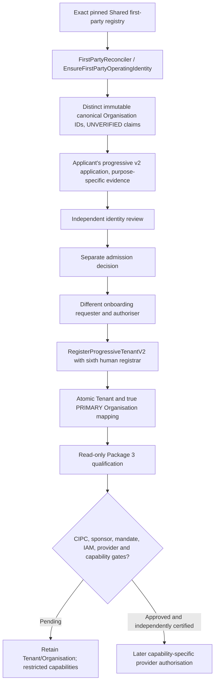

# Package 3 (PEO-04 / LA-06): controlled founding-business onboarding

**Architecture:** ADR-BCP-026 (PEO-04 / T04/T05/T12/T14/T19/T20/T21/T22) and ADR-BCP-027 (LA-06 / T01–T07/T10–T15/T21/T27–T30).  
**Document status:** code-level qualification and synthetic four-business integration; no live production founding tenant creation, CIPC certification, real legal-actor mandate or service activation.

## Objective and authority boundaries

| First-party business | Governed Shared identity | Actual corporate standing | Tenant requirement | Operating legal person |
|---|---|---|---|---|
| Nabhold Group Africa | `NABHOLD` / `LEGAL_PERSON` | CIPC declared, requires independently accepted CP verification | Own PRIMARY Organisation and Tenant | Nabhold only after required legal/source evidence |
| Thamani Global | `THAMANI-GLOBAL` / `LEGAL_PERSON` | Independently verify registration **and** Nabhold corporate control; ownership cannot be inferred from CIPC incorporation certificate | Distinct PRIMARY Organisation and Tenant | Thamani for its own authorised roles, not automatically Nabhold |
| ZuriBeans | `ZURIBEANS` / `OPERATING_BUSINESS` | Not separately incorporated | Distinct PRIMARY Organisation and Tenant; no fabricated legal company | Proposed Nabhold, **only** by independently approved, market/activity/role-scoped mandate |
| Equator & Estate Co. | `EQUATOR-ESTATE` / `OPERATING_BUSINESS` | Not separately incorporated | Distinct PRIMARY Organisation and Tenant; no fabricated legal company | Proposed Nabhold, **only** by independently approved mandate with any required title/licence/permit |

First-party Shared `baobab_tenant: true` is consumption intent, not proof of runtime tenancy, corporate existence, provider eligibility or permission to trade. Each business retains Option B market-entry/exit autonomy and independent IAM tenant access.

## Existing controlled mutation path — REUSE, DO NOT BYPASS



The path is already implemented under PEO-03C and LA-03; this increment **tests four applications through that same path** and provides a fail-closed read-only gate. The registry is not used as a high-privilege ad hoc tenant seeding source.

## Added Package 3 implementation

- `organisation.QualifyFoundingRoster` uses only parsed, pinned first-party declarations and current CP runtime state. Its logic is generic to all recognised first-party identities; it never hard-codes Nabhold names as policy privileges.
- `PostgresFoundingSnapshot` checks immutable first-party Organisation mapping, effective-dated PRIMARY tenant mapping, Tenant PRIMARY enforcement, separately governed incorporation profile posture, independently current founding sponsorship and current, individually approved legal-actor mandates. It fails on ambiguous/shared Tenant or Organisation identities, cross-form mismatches, inherited false incorporation records, missing live sponsorship, or missing mandated legal-actor scope.
- `cmd/qualify-founding-onboarding` prints the registry digest, exact Organisation/Tenant binding and missing gates. Exit 2 means the roster is still pending approval; even an exit 0 is **not** a capability or production go-live decision.
- `TestPEO04BFourFoundingBusinessShapesRequireIndependentGovernedTenantAdmission` exercises the real PostgreSQL 17 progressive reviewer, decider, requester, authoriser and registrar service transitions for **four distinct synthetic business profiles**. It proves no legal company, default seller mandate, outbox-independent entitlement or cross-tenant binding is fabricated by registration; duplicate/unauthorised cases are denied by the existing v2 system.
- `TestPEO04BQuadrupleFoundingIdentityTenantReadinessNoInventedCompany` and adversarial tests verify required gates and zero inferred sharing. `firstparty_operating_test.go` already demonstrates registry replay and stable Organisation IDs without fake incorporation.

## Critical scope distinction

An unincorporated Organisation may be admitted for low-risk uses without an operating mandate; **absence of legal-actor mandates only blocks operations whose authority requires one**, not the existence of an Organisation or Tenant. Likewise, an absent founding sponsorship blocks founding `INTERNAL` eligibility, not every unrelated commercial low-risk application. All legal/statutory/provider permission is checked at the particular operation. The qualification report describes required *founding-group restricted capabilities*, not a universal legal identity or tenant suspension.

## Operator procedure (real businesses)

1. Pin the accepted Shared first-party registry commit and verify its four declarations and documentary evidence references. Do not substitute applicant-input company IDs.
2. Read the output of merged Package 2 `cmd/reconcile-founding-evidence`. Both CIPC registration tracks and Nabhold→Thamani control remain independently PENDING until real source responses and reviewer approvals exist; never set them VERIFIED from synthetic fixtures.
3. Run `cmd/reconcile-first-party` using the same Shared pin. Stop on blocking drift (especially prior falsely VERIFIED LegalEntityProfile from Shared legacy membership); preserve audit and history.
4. Through **existing** PEO-03 v2 endpoints, create each business's own admission/review/decision/onboarding request with distinct authorised humans. Bind **reviewed** existing Organisation UUIDs instead of matching display names; do not automatically create or activate a Tenant from a registry row.
5. Apply actual `RegisterProgressiveTenantV2` only after decision and independent request authorisation. Record returned TenantIDs, verify separate PRIMARY Org mappings, enforce IAM tenant grants separately, and check source-generated provisioning outbox and entitlement readiness. Idempotent retries must preserve identifiers.
6. For ZuriBeans and Equator, independently approve `INTERNAL_GROUP_ADMISSION` founding sponsorship only when Nabhold identity and proposer/checker authority actually qualify. A 24-month documentary grace may apply **only to listed platform requirements**, never to CIPC incorporation, property permissions, statutory import/export, payroll, PSP or tenant isolation.
7. For any activity requiring a responsible legal actor, propose **separate** LA-04 mandates for the ZuriBeans and Equator Tenants, with actual role, activity, market, capability, time window, legal evidence and independent human checker. Proposed mandates remain PENDING until the official Nabhold legal-person verification requirement is met. No blanket Nabhold power, and no automatic Thamani mandate.
8. Run `qualify-founding-onboarding` on operator-controlled DB / pinned Shared registry. Review every `Missing` item. Never treat an affirmative identity+tenant report as final IAM/Subscription/Trade/ERP/Payments or deployment readiness.

### Executable check

```bash
# This reads only governed state. Exit status 2 means some gate remains pending.
DATABASE_URL=... \
  qualify-founding-onboarding \
  -registry /baobab/contracts/legal-entity/registry.yaml
```

## External acceptance and subsequent packages

Package 3 can be **engineering-complete** with green PostgreSQL/contract tests, but live onboarding remains blocked on authorised operator principals, approved admission decisions, real source verification of Nabhold and Thamani and separately accepted group-control/sponsorship/mandate evidence. Deployment, AWS identities and independently accepted PSP/Trade/ERP capability proofs belong to later packages. No seed, migration or integration test in this increment may set real first-party registration, corporate control or legal permissions VERIFIED.

**Do not start EA v2.1 evaluation or Package 4 consumer closure because a Package 3 synthetic test passes.**
